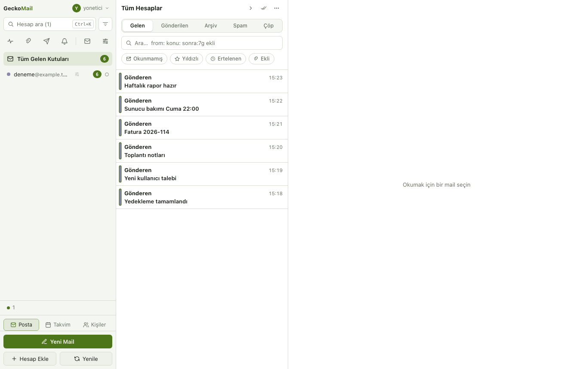

# GeckoMail

**Onlarca IMAP hesabını tek bir sakin ekranda yöneten, donmayan mail istemcisi.** [Kodviva](https://kodviva.com) tarafından geliştirilir, açık kaynaktır.

Birleşik gelen kutusu, otomasyon kuralları, hesap başına sağlık takibi ve cihaz ele geçse bile açılamayan yerel şifreleme. Masaüstünde sunucusuz çalışır, kendi sunucunuza kurarak web, masaüstü ve mobilden aynı posta kutularına erişirsiniz.

macOS · Windows · Web · iOS · Android · Docker sunucusu · AGPL-3.0



Ekran görüntüleri demo verisiyle üretilmiştir.

## Hızlı kurulum

Masaüstü: [sürümler](https://github.com/kodviva/geckomail-releases/releases) sayfasından indirin, hesap ekleyin.

Sunucu:

```bash
curl -O https://raw.githubusercontent.com/kodviva/geckomail/main/deploy/docker-compose.example.yml
mv docker-compose.example.yml docker-compose.yml
openssl rand -base64 32 > geckomail_key   # veriden ayrı yedekleyin
# GECKO_PUBLIC_ORIGIN değerini düzenleyin, önüne TLS sonlandıran ters vekil koyun
docker compose up -d
```

Ayrıntı: [`docs/kurulum.md`](docs/kurulum.md).

## Belgeler

- [Kurulum](docs/kurulum.md): Docker, ters vekil, `GECKO_*` tablosu
- [OAuth istemci kaydı](docs/oauth.md): Google, Microsoft
- [İstemciler](docs/istemciler.md): web, masaüstü, mobil, kayıp telefon
- [Bildirim ve röle](docs/bildirim.md)
- [Sieve](docs/sieve.md), [kişiler ve takvim](docs/kisiler-takvim.md), [S/MIME](docs/smime.md)
- [Yedek ve yükseltme](docs/yedek.md)
- [Gizlilik ve güvenlik sınırları](docs/GIZLILIK.md)

---

## Neden?

Standart mail istemcileri 5-10 hesapta boğulur, 60+ hesapta donar. GeckoMail onlarca gerçek IMAP
hesabıyla günlük kullanımda sınandı: tüm ağ ve disk işi ayrı bir süreçte döner, arayüz asla
beklemez. İzleme/uyarı kutuları (SLA, DMARC, bounce, Veeam, Twilio…) ile gerçek yazışmayı ayırt
etmek için tasarlandı.

## Öne çıkanlar

- **Birleşik gelen kutusu** — tüm hesaplar tek akışta, hesap-renkli, sanal listeyle akıcı kaydırma.
- **Donmayan mimari** — main / sync (utilityProcess) / sandbox'lı renderer; tipli RPC ile MessagePort üstünden.
- **Compose paketi** — ek gönderme, Bcc, imzalar, zengin metin (HTML), taslak kurtarma, çoklu seçim + toplu işlemler + Geri Al.
- **Çoklu kullanıcı + RBAC** — kullanıcılar, hesap grupları, gruba özel görüntüleme/yönetme yetkileri (uygulama-seviyesi).
- **Otomasyon** — koşullu kurallar (taşı/arşivle/spam/oku/yıldızla/ilet/webhook), giden webhook'lar, zamanlanmış görevler, şablonlar.
- **Sağlık Panosu + Duvar Modu** — tüm hesapların durumu tek ekranda; ikinci ekrana asılabilen ayrı bir ops-wallboard penceresi.
- **Gürültü azaltma** — tekrarlayan bildirim maillerini kümeler; hesap-başına sessizlik/patlama anomali alarmı; çapraz-hesap olay korelasyonu.
- **Arama & threading** — FTS5 arama (`from:` / `ekli` filtreleri, vurgu), konuşma görünümü, IDLE anlık mail.
- **Güvenli susturma** — RFC 8058 tek-tık `List-Unsubscribe` (yalnızca gerçekten güvenliyse).
- **Kasa modu (at-rest şifreleme)** — kritik hesapların içeriği + IMAP şifresi cihazda AES-256-GCM ile şifreli; kilitliyken açılamaz, aramada çıkmaz, arka planda yenilenmez.
- **Cihazlar arası senkron** — hesap listesi + kuralları kendi mail sunucundaki şifreli bir IMAP klasörüne yazar; başka cihazda aynı parolayla geri alırsın. Yeni sunucu gerektirmez.
- **İmzalı + notarize DMG** — Developer ID ile imzalı, Apple tarafından notarize edilmiş dağıtım.

## Güvenlik modeli (dürüst çerçeve)

- **RBAC**, gerçek çok-kiracılı izolasyon değil; aynı Mac'i paylaşan kişiler arası **uygulama-seviyesi** bir yetki katmanıdır.
- **Kasa modu** yerel cihaz kopyasını korur (parola cihazda saklanmaz, bellekte tutulur, kilitte silinir). Mail sunucusundaki düz-metin kopyayı **koruyamaz** — bu IMAP'in doğasıdır.
- **Cihazlar arası senkron** uçtan-uca şifrelidir (sunucu yalnızca ciphertext görür) ama tüm hesap şifrelerini senkron-parolasıyla şifreli olarak mail sunucuna yazar; senkron parolası çok değerlidir.
- IMAP şifreleri macOS `safeStorage` (Keychain) ile şifrelenir; uygulama-giriş parolaları `scrypt` ile tek-yönlü hash'lenir; mail HTML'i DOMPurify + sandbox iframe + CSP ile render edilir, uzak resimler varsayılan engelli, punycode oltalama kapısı var.

## S/MIME

.p12 içe aktarma, imzalama, şifreleme ve doğrulama. Kripto yalnız motorda çalışır, arayüz durum rozetlerini görür. Yeşil rozet yalnız doğrulanmış imza ve sağlam şifre içindir; kendinden imzalı sertifika "doğrulandı" sayılmaz.

- Özel anahtar kasada durur. Kasa açıkken uygulama belleğindedir.
- Sunucu kurulumunda bu uçtan uca şifreleme değildir: sunucu, imzalama ve şifre çözme sırasında düz metni görür.
- Kasa parolası kurulum genelidir. Veritabanına ve parolaya birlikte sahip olan kişi tüm anahtarları çözebilir. Bir üyenin parolasını sıfırlayan yönetici o üye olarak girip anahtarını kullanabilir; üye uyarılır, ama bu teknik olarak engellenemez.
- Konu şifrelenmez. Şifreli postalar aramada çıkmaz, çevrimdışı açılmaz ve diske düz yazılmaz.
- Güven listesi Mozilla e-posta kökleridir, yönetici kurum kökü ekleyebilir. İptal denetimi CRL iledir, OCSP yoktur.

## Kurulum & geliştirme

Gereksinimler: Node 22 veya üstü, macOS'ta Xcode komut satırı araçları.

```bash
npm install          # bağımlılıklar + native modül derlemesi
npm run dev          # geliştirme (hot-reload)
npm run typecheck    # tsc --noEmit
npm run test         # vitest (saf mantık birim testleri)
npm run smoke        # production build + "sync hazır" duman testi
npm run dist         # imzalı/notarize DMG (Developer ID + notarytool profili gerekir)
```

İmzalama/notarization için Keychain'de Developer ID sertifikası (birden çoksa `CSC_NAME` ile seçilir) ve bir
`notarytool` profili (`APPLE_KEYCHAIN_PROFILE`) gerekir. Bunlar olmadan `npm run dist` imzasız bir yerel build üretir.

## Masaüstü modları

Uygulama iki modda çalışır. Mod yalnız bu cihazın ayarıdır, Ayarlar › Genel'den değişir.

- **Yerel:** posta, hesaplar ve kurallar bu cihazda durur, IMAP'e cihaz bağlanır. Sunucu gerekmez.
- **Sunucu:** pencere kendi sunucunuzun web istemcisini açar, yerel eşitleme hiç başlamaz. Sunucu
  adresi `https:` olmalıdır, `http:` yalnız bu makineyi gösteren adreste kabul edilir. Sertifika
  hatası atlanmaz. Pencere kapalıyken de arka planda bağlantı kalır, bildirim gelir.

### Yerelden sunucuya taşıma

Ayarlar › Genel › taşıma, hesapları (parolalarıyla), kuralları, tetikleyicileri, webhook'ları,
şablonları ve ayarları sunucuya uçtan şifreli gönderir. Sunucu parolaları görebilir, bu yüzden hedef
adres her çalıştırmada onay kutusunda gösterilir. Yarım kalırsa kaldığı yerden sürer. Yerel veri
silinmez, mod kendiliğinden değişmez.

Kural ya da tetikleyici gönderilince yerelde otomasyon duraklar, iki yerde çalışmasın diye.
Bildirimler sürer, Ayarlar › Genel'den açılabilir.

Sunucuda başka kişilerin verisi olabilir, bu yüzden taşıma kapsamı genişletmez:

- Sunucuda başka hesaplar varsa genel kurallar ve tüm hesap özetleri kapalı gelir, özette yazılır.
- Sunucuda aynı adlı grup varsa birleştirilmez. Hesap grupsuz gelir, gruba bağlı kural engellenir.
  Her sunucuda bulunan `Genel` grubu da buna dahildir.
- Sunucuda zaten olan hesapta yalnız daha yeni parola yazılır, diğer ayarlar değişmez.
- Aynı adlı webhook başka adrese gidiyorsa ona bağlı kural engellenir.
- Yerelde aynı adı taşıyan ögeler (kural, webhook, tetikleyici) adları ayrılana dek gönderilmez.

**Taşınmayanlar:**

- Kasa kilitliyken kasa hesapları. Sunucuda açık kasa yoksa da gitmez, koruma sessizce düşürülmez.
- OAuth hesapları: belirteç bu uygulamaya bağlıdır, sunucuda yeniden bağlanır.
- Stalwart yönetim anahtarı, senkron parolası ve cihaz senkron verisi.
- Touch ID, Windows Hello ve passkey'ler: cihaza bağlıdır.
- Yerel kullanıcılar, parolaları ve iki adımlı kodları.
- Zamanlı gönderimler ve bekleyen işlemler: yerelde kalır, yerel moda dönünce sürer.
- Posta önbelleği, ekler ve kural günlüğü: sunucu IMAP'ten yeniden eşitler.
- Sieve ayarları ve tatil yanıtı: posta sunucusundaki `geckomail-rules` betiği yerinde kalır ve çalışır. Sunucuda Sieve kapalı geldiği için izlenen klasör yoktur: taşıma ile webhook, yönlendirme ya da bildirim içeren kuralların istemci yarısı çalışmaz, tatil yanıtı sürer. Böyle her hesap taşıma özetinde uyarılır; taşıdıktan sonra sunucuda Sieve'i açın.
- Kişisel kişiler ve takvimler: kaynakları sunucuda yeniden ekleyin.
- S/MIME kimlikleri: sertifikaları sunucuda yeniden içe aktarın.

**Bilinen sınırlar:** Cihaz senkronu kullanan ikinci bir masaüstünde otomasyon duraklatılmaz, kurallar
orada da çalışır. Taşınmış hesabın parolası sonradan yerelde değişirse sunucuya geçmez.
## Mobil uygulama

iOS ve Android kabuğu `mobile/` altındadır (Capacitor), arayüz aynı React kodudur. Uygulama yalnız sunucu moduyla çalışır: ilk açılışta sunucu adresi girilir.

Mobilde bilinmesi gerekenler:

- **Biyometrik kilit** uygulama kapısıdır, anahtar ACL'i değildir. Oturum belirteci cihaz kilidi ilk açıldıktan sonra okunabilir, çünkü bildirimden okundu ve arşivle uygulama kapalıyken çalışır. Kilit, kilidi açık telefonu eline alan kişiye karşıdır, jailbreak'li cihazdan çıkarmaya karşı değildir. Kilit açıkken bildirim eylemleri reddedilir.
- **Kendinden imzalı sertifika** desteklenmez. Sunucu `https` ve geçerli sertifika ister; sertifika iğneleme yoktur.
- **Oturum API'si sapması:** `/api/mobile/login` belirteci gövdede döndürür, çünkü çerez saklayacak aynı köken yoktur. Uç yalnız yerel HTTP içindir: `Origin` ya da `Sec-Fetch-*` taşıyan istek reddedilir, belirteç JS'e verilmez.
- **Röle** platform, APNs ortamı, motor açık anahtarı, sabit boylu şifreli kutu ve bağlantı anında IP görür, içerik görmez. Ayrıntı: `deploy/RELAY.md`. Web Push röleden geçmez.
- **Mobilde olmayanlar:** belirtecin ömrünü aşan her iş tarayıcıdadır: hesabın sunucusu, parolası ve kasa koruması, hesap açma kapama ve silme, Sieve yazımı ve tatil yanıtı, kişi ve takvim kaynağı, passkey, OAuth, yedek, kişi sertifikası, oturum listesi, yönetim işleri. Liste: [`docs/istemciler.md`](docs/istemciler.md).
- **Kasa kilitliyken** kasa hesaplarından bildirim gelmez.
- **S/MIME mobilde:** şifreli iletiler okunur, gönderilir. Kimlik ve kişi sertifikası işleri, çözülmüş eki kaydetme tarayıcıdadır. Ham Sieve betiği de mobilde yazılmaz.

Uçtan uca deneme: `mobile/e2e/README.md`. Mağaza metinleri: `mobile/store/`.

## Hesap ekleme

Uygulama içinden **+ Hesap Ekle** → `.mobileconfig` (Apple Mail profili) veya CSV:

```
email,password,imap_host,imap_port,smtp_host,smtp_port
ornek@firma.com,sifre,mail.firma.com,993,mail.firma.com,465
```

host/port boş bırakılırsa `mail.<domain>`, 993/465 varsayılır. Aynı adres tekrar içe aktarılırsa
şifresi güncellenir. Birden çok cihazda kullanmak için: bir cihazda kur, **Ayarlar → Cihazlar Arası
Senkron → Gönder**; diğer cihazda çapa hesabı ekleyip aynı parolayla **Al**.

## Kişiler ve takvim

CalDAV/CardDAV ve Microsoft Graph ile eşitlenen adres defterleri ve takvimler, iCal abonelikleri, postadaki davetlere kabul/ret/belki yanıtı ve hatırlatmalar.

- **Hesaba bağlama:** Hesap penceresinde "Kişi ve takvimi bağla". Parolalı hesapta parola yalnız posta sunucusuna ve e-posta alan adının altındaki sunuculara gider; başka bir sunucu bulunursa adı gösterilir, onay istenir.
- **Kişisel kaynak:** Ayarlar › Kişiler ve Takvim. Adresi ve parolayı siz girersiniz, kaynağı yalnız siz görürsünüz.
- **Google:** OAuth istemcisinde CalDAV API ve People/CardDAV açılır, izin ekranına `calendar` ve `carddav` kapsamları eklenir. Bu kapsamlar yalnız "Kişi ve takvimi bağla" sırasında istenir.
- **Microsoft 365:** Azure uygulamasına `Contacts.ReadWrite` ve `Calendars.ReadWrite` temsilci izinleri eklenir. Bu izinler de yalnız bağlama sırasında istenir; kiracı yöneticisi izni kapattıysa posta çalışmaya devam eder.
- **Sunucu modunda iç ağ:** Sunucu varsayılan olarak iç ağdaki DAV sunucularına gitmez. İzin vermek için `GECKO_DAV_PRIVATE_HOSTS=dav.lan:5232,radicale` (`ad:port`; çıplak ad 80, 443 ve 8443 demektir). iCal abonelikleri ve webhook'lar bu listeden yararlanmaz: sunucu modunda iç ağa hiç gitmezler. Masaüstünde webhook ve DAV adresini kullanıcı yazdığı için iç ağ serbesttir.
- **Davetler:** Hiçbir şey tıklamasız uygulanmaz. Güncelleme ve iptal yalnız takvimdeki etkinliğin düzenleyeninden kabul edilir. Davet gönderme yoktur.
- **S/MIME şifreli davetler yanıtlanamaz:** Takvim parçası şifreli gövdenin içindedir, davet eki olarak görülmez. İleti okunur, kabul/ret/belki düğmeleri çıkmaz. Yanıtı düzenleyene postayla ya da takvimden verin.
- **Çevrimdışı (web):** Açıksa kişi özetleri (en çok 5000) ve geçen aydan altı ay sonrasına kadar takvim tarayıcıda şifreli saklanır, salt okunur açılır.

## Kurtarma araçları

Yerel, terminalde, hiçbir şey ağa gitmez:

```bash
npm run reset-password   # bir kullanıcının uygulama-giriş parolasını sıfırla
npm run reset-vault      # kasa parolası kaybında son çare (YIKICI: kasa hesaplarını siler)
```

## Mimari

```
main (Electron)  ──MessagePort──  sync (utilityProcess)  ──IMAP/SMTP──  mail sunucusu
      │                                   │
   pencereler,                        SQLite (WAL), zamanlayıcı (host başına 4 slot,
   Keychain köprüsü                   120s±20s kadans, devre kesici), op-kuyruğu,
      │                               kurallar motoru, kasa kriptosu, FTS5
   renderer (sandbox, React) ── tipli RPC ── sync
```

- `src/main` — pencere yönetimi, Keychain (safeStorage) köprüsü, sync sürecini denetleme
- `src/sync` — IMAP zamanlayıcı + artımlı senkron (UIDVALIDITY/UIDNEXT/CONDSTORE), op kuyruğu (outbox), SQLite+FTS5, kurallar/kasa/senkron modülleri
- `src/renderer` — React + sanal liste; tüm ağ/disk işi sync'te, renderer yalnızca `src/shared/rpc.ts` sözleşmesine karşı derlenir

## Lisans

[AGPL-3.0-only](LICENSE), ek koşullar [`NOTICE`](NOTICE) dosyasındadır: "GeckoMail · Kodviva" atfı değiştirilmiş sürümlerde korunur, Firebase istemci kitaplıklarıyla bağlamaya izin verilir. Ad ve logo lisansa dahil değildir: [`TRADEMARKS.md`](TRADEMARKS.md). Katkı için [`CONTRIBUTING.md`](CONTRIBUTING.md) ve [`CLA.md`](CLA.md), güvenlik bildirimi için [`SECURITY.md`](SECURITY.md).

© 2026 Kodviva
